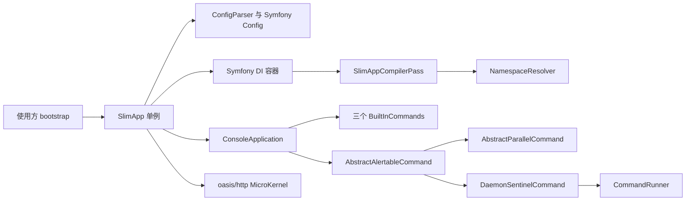

# 当前架构

本页描述组件职责与装配关系；使用方法从用户指南进入。

## 运行视图

使用方引导文件取得 SlimApp 单例，完成初始化后选择 Console 或 HTTP 入口。

## 组件职责

实现保持在 `Oasis\SlimApp` 命名空间，不引入业务工程的实体与路由。

| 组件 | 职责 |
| --- | --- |
| SlimApp | 配置、容器、日志装配；惰性提供 Console 与 MicroKernel |
| ConfigParser | 委托 schema 合并校验、生成点号参数、检索扁平参数 |
| SlimAppCompilerPass | 在命名空间参数有效时配置 app 工厂并解析短类名 |
| NamespaceResolver | 按候选命名空间顺序解析现有类 |
| ConsoleApplication | Symfony Console 扩展，装配终端与命令日志 |
| AbstractAlertableCommand | 异常告警后重抛 |
| AbstractParallelCommand | 并行执行、等待与子进程重启 |
| Sentinel 三类 | 配置校验、命令实例调度和子进程回收 |
| BuiltInCommands | 生成使用方工程、清缓存、检查可获取服务 |

工程生成命令调用四个模板 trait，分别生成配置 schema、数据库、服务 YAML 和单测文件。
模板复用命令的临时文件写入与覆盖确认流程，不改变生成入口。

## 约束与主题归属

各类契约只在其主题页定义，本页保留依赖方向。

- 配置解析及注入规则见[运行时配置](../operations/configuration.md)。
- 容器与内部 API 见[内部接口](../interfaces/internal.md)。
- 缓存格式及生命周期见[缓存数据](../data/cache.md)。
- 异常与退出码见[错误模型](../interfaces/errors.md)。
- 使用方 API 与命令操作见[用户指南](../../user-guide/README.md)。
- 仓库没有单独的已确认 ADR；旧设计材料只用于历史追溯。
